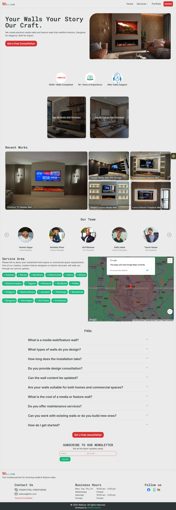

# Walluxe Frontend – Media & Feature Wall Services

This is the frontend of Walluxe, a service platform for premium media wall and feature wall.  
Built with **Next.js**, **Tailwind CSS**, and **shadcn/ui** for a modern, responsive, and interactive user experience.

---

## 🔗 Quick Links

🔵[**Live link**](https://walluxe-web.vercel.app/)

🔵[**Backend Repo**](https://github.com/mahim-dewan/walluxe-api)

## 🚀 Tech Stack

- [Next.js 14](https://nextjs.org/) – React framework with App Router
- [Tailwind CSS](https://tailwindcss.com/) – utility-first CSS framework
- [shadcn/ui](https://ui.shadcn.com/) – accessible UI components
- [Lucide Icons](https://lucide.dev/) – icons for UI
- [LDRS](https://uiball.com/ldrs/) – Loader spinner

---

## 🎯 Core Features

- Fully responsive UI & SEO-friendly structure

- Packages pages (Media & Feature walls)

- Portfolio page with dynamic details pages

- Booking feature for a Package

- Payment integration with SSLCommerz

- REST API integration ready

- Loader/Spinner for UX feedback

## Screenshot



## ⚙️ Installation & Setup

#### 1️⃣ Clone the repository

```bash
git clone https://github.com/mahim-dewan/walluxe-frontend.git

cd walluxe-frontend
```

#### 2️⃣ Install dependencies

```bash
npm install
```

#### 3️⃣ Start development server

```bash
npm run dev
```

## 🔗 Environment Variables

Create a .env file in the project root:

```bash
NEXT_PUBLIC_DOMAIN="http://localhost:3000"

# Google Map Integration
NEXT_PUBLIC_GOOGLE_MAPS_API_KEY="your_api_key"

BASE_API="http://localhost:5000/api"
```

## 📦 Build for Production

```bash
npm run build
npm run start
```

## Author

**Mahim Dewan**  
MERN stack web developer  
[Facebook](https://www.facebook.com/MahimDewan3377)  
[Linkedin](https://www.linkedin.com/in/mahim-dewan79/)  
[Whatsapp](https://wa.me/8801568517556)  
[Email](mailto:mahimdewan79@gmail.com)
